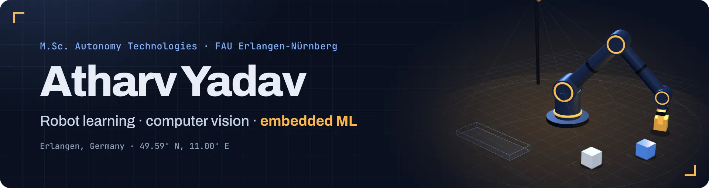

  

  
  
  

 

I'm a master's student in **Autonomy Technologies** at FAU Erlangen-Nürnberg, with a background in computer vision, machine learning on embedded hardware, and Linux and C. I'm moving into robotics and Physical AI, especially vision-language-action models and learned robot policies.

 

## Selected work

<table>
  <tr>
    <td width="34%"><b>AUTODIDACT</b> Siemens Healthineers Robotics &amp; AI Hackathon 2026 · semi-finalists</td>
    <td>A self-improving robot learning loop for a two-arm Franka FR3 Duo in MuJoCo. It checks the demonstration data, trains a policy (ACT, SmolVLA), finds where it fails, requests demonstrations there, and only promotes a model that is statistically better. Team project; I worked on data checks, the simulation twin, training and evaluation.</td>
  </tr>
  <tr>
    <td><b><a href="https://github.com/omom77/3d_print_failure_detection_cv">3D Print Failure Detection</a></b> Published · Springer LNNS, ICSCSP-2025</td>
    <td>A YOLOv8 model that tells failed 3D prints from good ones. I built and annotated the dataset in Roboflow and trained the model; combining it with a public dataset made the detector noticeably more reliable.</td>
  </tr>
  <tr>
    <td><b>MedFusion AI</b> B.Tech project · team</td>
    <td>Separate models for four diagnostic tasks, deployed on a Raspberry Pi acting as a hospital server. I handled the datasets, model training (TensorFlow/Keras, Random Forest) and the Pi deployment.</td>
  </tr>
  <tr>
    <td><b><a href="https://github.com/Atharv2k4/RAG">Document RAG pipeline</a></b> Python · notebook</td>
    <td>Question answering over text and PDF files with LangChain, Sentence Transformers embeddings in ChromaDB, and a Groq-hosted LLM.</td>
  </tr>
</table>

 

## Toolbox

  
  
  
  
  
  
  
  
  
  

 

Erlangen, Germany · English, German (B1), Marathi, Hindi
